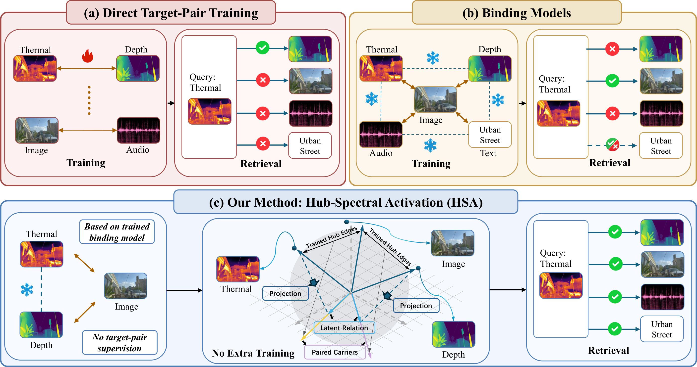
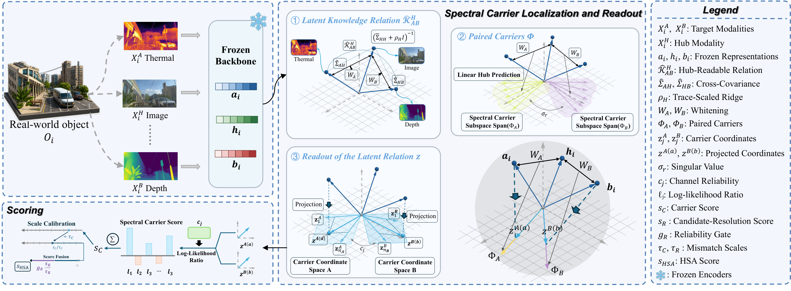

<div align="center">

# Hub-Spectral Activation of Latent Multimodal Knowledge

**HSA · Recovering and activating cross-modal relations in frozen representations**

Ying Guo, Haidong Chen, Linrui Xu, Xiaohao Liu, Chuancheng Shi, Canran Xiao, Dan Zhang, Fei Shen, Li Shen, Tat-Seng Chua

[Overview](#overview) · [Method](#method) · [Results](#main-results) · [Installation](#installation) · [Data](#datasets) · [Usage](#usage)

</div>

## Overview

**Hub-Spectral Activation (HSA)** recovers and activates cross-modal relations in frozen representations through a shared hub. It uses source hub-edge statistics to construct closed-form scores for bidirectional retrieval and prototype classification.



## Method

HSA composes the two observed hub edges, identifies paired spectral carriers and combines carrier matching with source-gated candidate resolution. Backbone parameters remain frozen throughout fitting and evaluation.



## Main results

| Backbone | Retrieval relations | Frozen cosine R@10 | HSA R@10 | Classification relations | Frozen cosine macro Top-1 | HSA macro Top-1 |
|---|---:|---:|---:|---:|---:|---:|
| ImageBind | 9 | 10.80% | **24.90%** | 6 | 16.31% | **44.01%** |
| LanguageBind | 10 | 25.00% | **36.79%** | 5 | 44.25% | **62.53%** |
| All | 19 | 18.27% | **31.15%** | 11 | 29.01% | **52.43%** |

Results reported in the paper. Retrieval averages both directions; classification averages accuracy across classes. Overall results weight each relation equally.

## Installation

Requires Git, Conda and an NVIDIA GPU with a compatible driver. The commands below install the Python 3.10 environment and CUDA 12.1 build used by the standard extraction setup.

```bash
git clone https://github.com/Luo1Yan/HSA.git
cd HSA
conda create -n hsa python=3.10 -y
conda activate hsa
python -m pip install torch==2.1.0 torchvision==0.16.0 torchaudio==2.1.0 --index-url https://download.pytorch.org/whl/cu121
python -m pip install -r environments/standard.txt
```

For CPU execution, select the [CPU PyTorch build](https://pytorch.org/get-started/previous-versions/) and use `--device cpu`. Extraction dependencies include the media decoder.

## Usage

Three entry points handle data acquisition, feature extraction, and HSA fitting/evaluation. For example, run both UTD-MHAD tasks with:

```bash
python download.py --dataset utd-mhad --fetch
python extract.py --dataset utd-mhad --device cuda
python run.py --dataset utd-mhad --device cuda --output outputs/utd.json
```

Results are saved to `outputs/utd.json`. `run.py` evaluates HSA and frozen cosine. The UTD-MHAD HSA reference results are **9.30% retrieval R@10** and **34.75% classification macro Top-1**.

Use the same `--dataset`, `--backbone`, `--task` and `--relation` selection across the three commands. `--data-root` defaults to `datasets`; `--model-root` defaults to `models`.

```bash
python run.py --list
python extract.py --dataset utd-mhad --check-inputs
python run.py --dataset utd-mhad --check-data
```

`download.py` shows the download plan without `--fetch`. Extraction resumes from completed features; `--force` regenerates them. Missing input files are reported in `datasets/checks/`.

## Datasets

Supported dataset names:

`utd-mhad`, `ucf101`, `nyuv2`, `vggsound`, `tartan-rgbt`, `batvision`, `mavd`, `caltech-rgbt`, `msrvtt`, `ego4d`.

The download entry point includes the public data links and model weights. Public downloads require no Hugging Face account. **Ego4D requires [official access](https://ego4d-data.org/docs/start-here/)**: obtain the v2 full-scale videos, IMU CSVs and narration annotations, then place them under `datasets/raw/ego4d/`. Required video IDs and IMU filenames are listed in `configs/ego4d.json`.

### All main experiments

After preparing Ego4D, run the following from the repository directory. Full video datasets require substantial storage; inspect the download plan before fetching.

```bash
conda activate hsa
python download.py
python download.py --fetch --skip-manual
python extract.py --environment standard --device cuda
```

NYUv2 official classification and VGGSound-309 classification use a separate extraction environment:

```bash
conda create -n hsa-cls python=3.10 -y
conda activate hsa-cls
python -m pip install torch==2.8.0 torchvision==0.23.0 torchaudio==2.8.0 --index-url https://download.pytorch.org/whl/cu129
python -m pip install -r environments/classification.txt
python extract.py --environment classification --device cuda
```

Choose a compatible [PyTorch GPU build](https://pytorch.org/get-started/previous-versions/) for the installed driver. Both environments write to the same data directory. Fit and evaluate all 19 retrieval and 11 classification experiments with:

```bash
python run.py --check-data
python run.py --device cuda --output outputs/main.json
```

## Citation

```bibtex
@misc{guo2026hsa,
  title={Hub-Spectral Activation of Latent Multimodal Knowledge},
  author={Guo, Ying and Chen, Haidong and Xu, Linrui and Liu, Xiaohao and
          Shi, Chuancheng and Xiao, Canran and Zhang, Dan and Shen, Fei and
          Shen, Li and Chua, Tat-Seng},
  year={2026},
  note={Manuscript},
  url={https://github.com/Luo1Yan/HSA}
}
```
