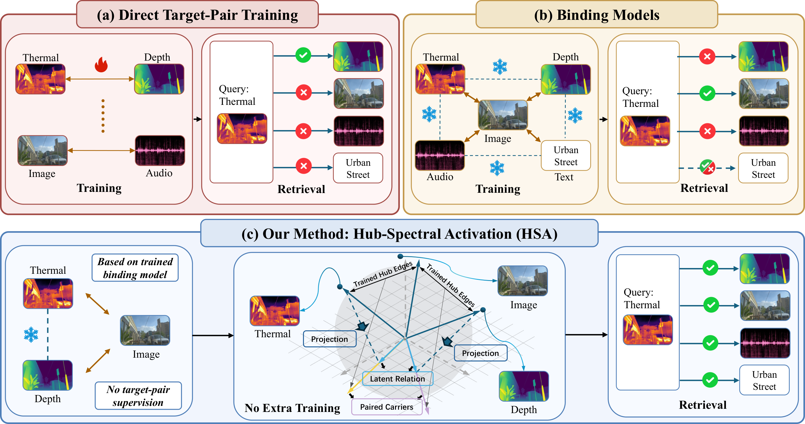
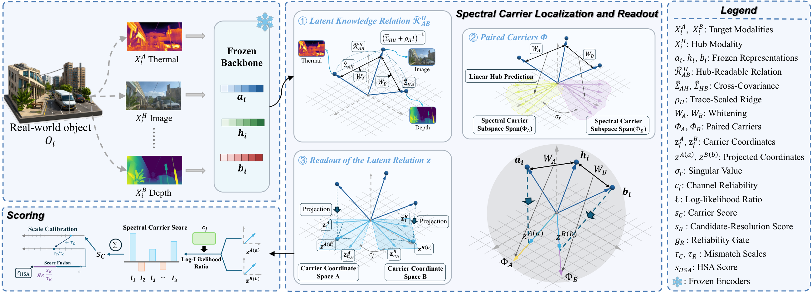

<div align="center">

# Hub-Spectral Activation of Latent Multimodal Knowledge

**HSA · Recovering and activating cross-modal relations in frozen representations**

Ying Guo, Haidong Chen, Linrui Xu, Xiaohao Liu, Chuancheng Shi, Canran Xiao, Dan Zhang, Fei Shen, Li Shen, Tat-Seng Chua

English · [简体中文](README.zh-CN.md)

[Paper](https://arxiv.org/abs/2609.17094) · [Features](https://huggingface.co/datasets/Rowance/HSA-features) · [Overview](#overview) · [Method](#method) · [Results](#main-results) · [Installation](#installation) · [Data](#datasets) · [Usage](#usage) · [Structure](#project-structure) · [Citation](#citation)

</div>

## Overview

**Hub-Spectral Activation (HSA)** recovers and activates cross-modal relations in frozen representations through a shared hub. It uses source hub-edge statistics to construct closed-form scores for bidirectional retrieval and prototype classification.



## Method

HSA composes the two observed hub edges, identifies paired spectral carriers and combines carrier matching with source-gated candidate resolution. Backbone parameters remain frozen throughout fitting and evaluation.



## Main results

| Backbone | Retrieval relations | Frozen cosine R@10 | HSA R@10 | Classification relations | Frozen cosine macro Top-1 | HSA macro Top-1 |
|---|---:|---:|---:|---:|---:|---:|
| ImageBind | 9 | 10.80% | **24.90%** | 6 | 16.31% | **44.01%** |
| LanguageBind | 10 | 25.00% | **36.79%** | 5 | 44.25% | **62.53%** |
| All | 19 | 18.27% | **31.15%** | 11 | 29.01% | **52.43%** |

Results reported in the paper. Retrieval averages both directions; classification averages accuracy across classes. Overall results weight each relation equally.

The public runner covers the **HSA and frozen-cosine entries** in the main retrieval and classification tables. Other comparison methods, ablations and mechanism analyses require separate experiment code.

## Installation

The standard GPU extraction setup uses Git, Conda and an NVIDIA GPU with a compatible driver. The commands below install the Python 3.10 environment and CUDA 12.1 build used by this setup.

```bash
git clone https://github.com/Luo1Yan/HSA.git
cd HSA
conda create -n hsa python=3.10 -y
conda activate hsa
python -m pip install torch==2.1.0 torchvision==0.16.0 torchaudio==2.1.0 --index-url https://download.pytorch.org/whl/cu121
python -m pip install -r environments/standard.txt
```

For CPU execution, select the [CPU PyTorch build](https://pytorch.org/get-started/previous-versions/) and use `--device cpu`. Extraction dependencies include the media decoder.

## Prepared features

Frozen features for 26 of the 30 main relations (17 retrieval and 9 classification; all datasets except Ego4D) are available on [Hugging Face](https://huggingface.co/datasets/Rowance/HSA-features). Evaluating them needs only the evaluation dependencies, without the encoders or the original data:

```bash
python -m pip install -r requirements.txt huggingface_hub
hf download Rowance/HSA-features --repo-type dataset --local-dir datasets
for d in tartan-rgbt vggsound caltech-rgbt batvision utd-mhad ucf101 nyuv2 msrvtt mavd; do
  python run.py --dataset $d --output outputs/$d.json
done
```

Select experiments by dataset as above; `run.py` without a selection expects all 30 archives. Each archive keeps the terms listed on the [dataset card](https://huggingface.co/datasets/Rowance/HSA-features). The four Ego4D archives can be generated by Ego4D licensees with the steps under [Usage](#usage).

## Usage

Three entry points handle data acquisition, feature extraction, and HSA fitting/evaluation. For example, run both UTD-MHAD tasks with:

```bash
python download.py --dataset utd-mhad --fetch
python extract.py --dataset utd-mhad --device cuda
python run.py --dataset utd-mhad --device cuda --output outputs/utd.json
```

Results are saved to `outputs/utd.json`. `run.py` evaluates HSA and frozen cosine. The UTD-MHAD HSA reference results are **9.30% retrieval R@10** and **34.75% classification macro Top-1**.

Use the same `--dataset`, `--backbone`, `--task` and `--relation` selection across the three commands. `--data-root` defaults to `datasets`; `--model-root` defaults to `models`.

```bash
python run.py --list
python extract.py --dataset utd-mhad --check-inputs
python run.py --dataset utd-mhad --check-data
```

`download.py` shows the download plan without `--fetch`. Extraction resumes from completed features; `--force` regenerates them. Missing input files are reported in `datasets/checks/`.

For existing feature archives, see the [feature format and evaluation instructions](docs/feature-format.md). Evaluation of prepared features only requires `requirements.txt`.

## Datasets

| Dataset argument | Original-data source used by the entry point |
|---|---|
| `utd-mhad` | [UT Dallas](https://personal.utdallas.edu/~kehtar/UTD-MHAD.html) |
| `ucf101` | [UCF101 mirror](https://huggingface.co/datasets/NoahMartinezXiang/2013_UCF101) |
| `nyuv2` | [Depth mirror](https://huggingface.co/datasets/sayakpaul/nyu_depth_v2) and [official labeled data](https://cs.nyu.edu/~fergus/datasets/nyu_depth_v2.html) |
| `vggsound` | [Video mirror](https://huggingface.co/datasets/Loie/VGGSound) and [test-audio mirror](https://huggingface.co/datasets/txya900619/vggsound-16k) |
| `tartan-rgbt` | [Official TartanRGBT release](https://huggingface.co/datasets/theairlabcmu/TartanRGBT) |
| `batvision` | [Official BatVision release](https://doi.org/10.57745/HYLZNL) |
| `mavd` | [Official MAVD release](https://multimodal-distill.cs.uni-freiburg.de/) |
| `caltech-rgbt` | [Official Caltech Aerial RGBT release](https://data.caltech.edu/records/cks6g-ps927) |
| `msrvtt` | [PMRL's original-data mirror](https://huggingface.co/datasets/xhLiu/MM_eval) |
| `ego4d` | [Official access instructions](https://ego4d-data.org/docs/start-here/) |

Dataset and checkpoint licenses remain those of their respective providers. See [third-party sources](THIRD_PARTY.md) and [text-template licenses](licenses/README.md).

The download entry point includes the public data links and model weights. Public downloads require no Hugging Face account. **Ego4D requires [official access](https://ego4d-data.org/docs/start-here/)**: obtain the v2 full-scale videos, IMU CSVs and narration annotations, then place them under `datasets/raw/ego4d/`. Required video IDs and IMU filenames are listed in `configs/ego4d.json`.

### All main experiments

After preparing Ego4D, run the following from the repository directory. Full video datasets require substantial storage; the configured BatVision downloads alone total about 168.5 GB before extraction. Inspect the download plan before fetching.

```bash
conda activate hsa
python download.py
python download.py --fetch --skip-manual
python extract.py --environment standard --device cuda
```

NYUv2 official classification and VGGSound-309 classification use a separate extraction environment:

```bash
conda create -n hsa-cls python=3.10 -y
conda activate hsa-cls
python -m pip install torch==2.8.0 torchvision==0.23.0 torchaudio==2.8.0 --index-url https://download.pytorch.org/whl/cu129
python -m pip install -r environments/classification.txt
python extract.py --environment classification --device cuda
```

Choose a compatible [PyTorch GPU build](https://pytorch.org/get-started/previous-versions/) for the installed driver. Both environments write to the same data directory. Fit and evaluate all 19 retrieval and 11 classification experiments with:

```bash
python run.py --check-data
python run.py --device cuda --output outputs/main.json
```

### Reproduction scope

Evaluation on archived features has been verified for all 19 retrieval and 11 classification relations. Verification of the complete raw-data extraction and evaluation workflow currently covers UTD-MHAD. Full fresh acquisition and re-extraction of all ten datasets remains to be verified.

LanguageBind video extraction fixes a random seed per observation. Historical UCF101 and TartanRGBT video caches have unrecorded random flips, so regenerated video features can differ from those historical vectors.

## Project structure

```text
HSA/
  download.py         # Download original data and encoder weights
  extract.py          # Prepare inputs and extract frozen features
  run.py              # Fit HSA and evaluate retrieval/classification
  hsa.py              # HSA method implementation
  protocols.py        # Shared experiment selection and configuration
  configs/            # Sample IDs, splits, prompts and download sources
  environments/       # Extraction environment dependencies
  requirements.txt    # Dependencies for evaluation only
  docs/               # Feature archive format and evaluation instructions
  tests/              # Automated checks
  assets/             # Overview and method figures
  licenses/           # License files
  datasets/           # Local raw data and features (generated)
  models/             # Local encoder source and weights (downloaded)
  outputs/            # Evaluation results (generated)
```

## Tests

The protocol and download checks use synthetic fixtures and a local HTTP server:

```bash
python -m unittest discover -s tests -v
```

## Citation

```bibtex
@misc{guo2026hsa,
  title={Hub-Spectral Activation of Latent Multimodal Knowledge},
  author={Guo, Ying and Chen, Haidong and Xu, Linrui and Liu, Xiaohao and
          Shi, Chuancheng and Xiao, Canran and Zhang, Dan and Shen, Fei and
          Shen, Li and Chua, Tat-Seng},
  year={2026},
  eprint={2609.17094},
  archivePrefix={arXiv},
  primaryClass={cs.CV},
  doi={10.48550/arXiv.2609.17094},
  url={https://arxiv.org/abs/2609.17094}
}
```
