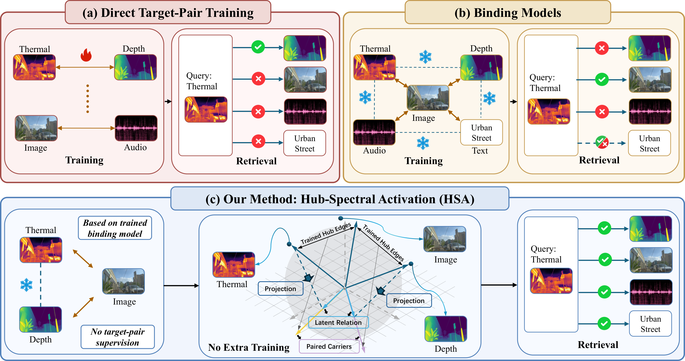
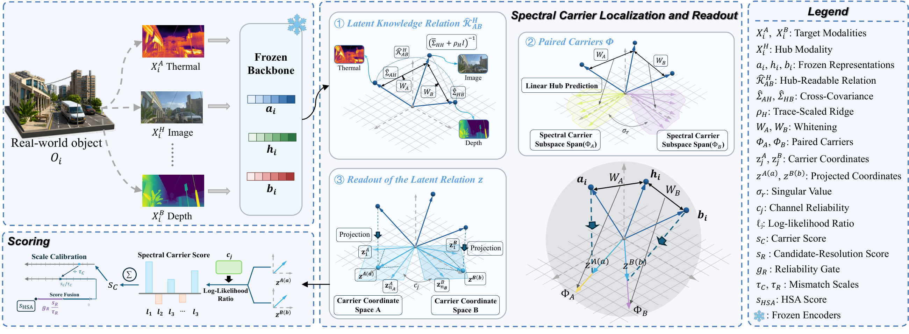

<div align="center">

# 潜在多模态知识的枢纽谱激活

**HSA · 恢复并激活冻结表征中的跨模态关系**

Ying Guo, Haidong Chen, Linrui Xu, Xiaohao Liu, Chuancheng Shi, Canran Xiao, Dan Zhang, Fei Shen, Li Shen, Tat-Seng Chua

[English](README.md) · 简体中文

[论文](https://arxiv.org/abs/2609.17094) · [特征下载](https://huggingface.co/datasets/Rowance/HSA-features) · [概述](#概述) · [方法](#方法) · [主要结果](#主要结果) · [安装](#安装) · [数据集](#数据集) · [使用方法](#使用方法) · [项目结构](#项目结构) · [引用](#引用)

</div>

## 概述

**枢纽谱激活（HSA）**通过共享的枢纽模态，恢复并激活冻结表征中的跨模态关系。它利用已观测枢纽边的统计量，构建用于双向检索和原型分类的闭式评分函数。



## 方法

HSA 组合两条已观测的枢纽边，识别成对的谱载体，并将载体匹配与源端门控的候选消歧相结合。在整个拟合与评测过程中，骨干模型参数始终保持冻结。



## 主要结果

| 骨干模型 | 检索关系数 | 冻结特征余弦基线 R@10 | HSA R@10 | 分类关系数 | 冻结特征余弦基线宏平均 Top-1 | HSA 宏平均 Top-1 |
|---|---:|---:|---:|---:|---:|---:|
| ImageBind | 9 | 10.80% | **24.90%** | 6 | 16.31% | **44.01%** |
| LanguageBind | 10 | 25.00% | **36.79%** | 5 | 44.25% | **62.53%** |
| 总体 | 19 | 18.27% | **31.15%** | 11 | 29.01% | **52.43%** |

以上为论文报告的结果。检索指标取两个检索方向的平均值；分类指标对各类别的准确率取平均值。总体结果对各关系等权平均。

公开的评测入口覆盖主检索表和主分类表中的 **HSA 与冻结特征余弦基线**。其他对比方法、消融实验和机制分析需要单独的实验代码。

## 安装

标准的 GPU 特征提取环境需要 Git、Conda，以及配有兼容驱动的 NVIDIA 显卡。以下命令安装该环境使用的 Python 3.10 和 CUDA 12.1 版 PyTorch。

```bash
git clone https://github.com/Luo1Yan/HSA.git
cd HSA
conda create -n hsa python=3.10 -y
conda activate hsa
python -m pip install torch==2.1.0 torchvision==0.16.0 torchaudio==2.1.0 --index-url https://download.pytorch.org/whl/cu121
python -m pip install -r environments/standard.txt
```

如需在 CPU 上运行，请选择 [CPU 版 PyTorch](https://pytorch.org/get-started/previous-versions/)，并使用 `--device cpu`。特征提取的依赖还包括媒体解码器。

## 预提取特征

30 个主实验关系中，有 26 个关系的冻结特征已在 [Hugging Face](https://huggingface.co/datasets/Rowance/HSA-features) 公开，覆盖 17 项检索和 9 项分类，包含除 Ego4D 外的全部数据集。使用这些特征进行评测，只需安装评测依赖，无需加载编码器或下载原始数据：

```bash
python -m pip install -r requirements.txt huggingface_hub
hf download Rowance/HSA-features --repo-type dataset --local-dir datasets
for d in tartan-rgbt vggsound caltech-rgbt batvision utd-mhad ucf101 nyuv2 msrvtt mavd; do
  python run.py --dataset $d --output outputs/$d.json
done
```

请像上面这样按数据集选择实验；直接运行 `run.py` 而不指定选择条件时，需要全部 30 个特征文件。各文件遵循[数据集说明页](https://huggingface.co/datasets/Rowance/HSA-features)列出的相应条款。持有 Ego4D 访问许可的用户，可按[使用方法](#使用方法)中的步骤生成其余 4 个 Ego4D 特征文件。

## 使用方法

三个入口分别负责数据获取、特征提取，以及 HSA 的拟合与评测。例如，运行 UTD-MHAD 的检索和分类两项任务：

```bash
python download.py --dataset utd-mhad --fetch
python extract.py --dataset utd-mhad --device cuda
python run.py --dataset utd-mhad --device cuda --output outputs/utd.json
```

结果保存在 `outputs/utd.json`。`run.py` 同时评测 HSA 和冻结特征余弦基线。UTD-MHAD 上 HSA 的参考结果为：**检索 R@10 为 9.30%**，**分类宏平均 Top-1 为 34.75%**。

三个命令应使用相同的 `--dataset`、`--backbone`、`--task` 和 `--relation` 选择条件。`--data-root` 默认为 `datasets`；`--model-root` 默认为 `models`。

```bash
python run.py --list
python extract.py --dataset utd-mhad --check-inputs
python run.py --dataset utd-mhad --check-data
```

`download.py` 在未指定 `--fetch` 时仅显示下载计划。特征提取会跳过已完成的特征；使用 `--force` 可重新生成。缺失的输入文件会记录在 `datasets/checks/` 中。

如需使用已有特征文件，请参阅[特征格式与评测说明](docs/feature-format.md)。评测预提取特征只需安装 `requirements.txt` 中的依赖。

## 数据集

| 数据集参数 | 下载入口使用的原始数据来源 |
|---|---|
| `utd-mhad` | [得克萨斯大学达拉斯分校](https://personal.utdallas.edu/~kehtar/UTD-MHAD.html) |
| `ucf101` | [UCF101 镜像](https://huggingface.co/datasets/NoahMartinezXiang/2013_UCF101) |
| `nyuv2` | [深度数据镜像](https://huggingface.co/datasets/sayakpaul/nyu_depth_v2)与[官方标注数据](https://cs.nyu.edu/~fergus/datasets/nyu_depth_v2.html) |
| `vggsound` | [视频镜像](https://huggingface.co/datasets/Loie/VGGSound)与[测试集音频镜像](https://huggingface.co/datasets/txya900619/vggsound-16k) |
| `tartan-rgbt` | [TartanRGBT 官方发布](https://huggingface.co/datasets/theairlabcmu/TartanRGBT) |
| `batvision` | [BatVision 官方发布](https://doi.org/10.57745/HYLZNL) |
| `mavd` | [MAVD 官方发布](https://multimodal-distill.cs.uni-freiburg.de/) |
| `caltech-rgbt` | [Caltech Aerial RGBT 官方发布](https://data.caltech.edu/records/cks6g-ps927) |
| `msrvtt` | [PMRL 提供的原始数据镜像](https://huggingface.co/datasets/xhLiu/MM_eval) |
| `ego4d` | [官方访问说明](https://ego4d-data.org/docs/start-here/) |

数据集和模型检查点各自遵循其提供方的许可。请参阅[第三方来源](THIRD_PARTY.md)和[文本模板许可](licenses/README.md)。

下载入口包含公开数据链接和模型权重。下载公开资源无需 Hugging Face 账号。**Ego4D 需要取得[官方访问许可](https://ego4d-data.org/docs/start-here/)**：获取 v2 全量视频、IMU CSV 文件和叙述标注后，将它们放入 `datasets/raw/ego4d/`。所需视频编号和 IMU 文件名列在 `configs/ego4d.json` 中。

### 全部主实验

准备好 Ego4D 后，在仓库目录中运行以下命令。完整视频数据集需要较大的存储空间；仅当前配置中的 BatVision 下载文件，在解压前就约为 168.5 GB。请先查看下载计划，再开始下载。

```bash
conda activate hsa
python download.py
python download.py --fetch --skip-manual
python extract.py --environment standard --device cuda
```

NYUv2 官方标注数据的分类实验和 VGGSound-309 分类实验使用单独的特征提取环境：

```bash
conda create -n hsa-cls python=3.10 -y
conda activate hsa-cls
python -m pip install torch==2.8.0 torchvision==0.23.0 torchaudio==2.8.0 --index-url https://download.pytorch.org/whl/cu129
python -m pip install -r environments/classification.txt
python extract.py --environment classification --device cuda
```

请根据已安装的驱动选择兼容的 [PyTorch GPU 版本](https://pytorch.org/get-started/previous-versions/)。两个环境将特征写入同一数据目录。以下命令对全部 19 项检索和 11 项分类实验进行拟合与评测：

```bash
python run.py --check-data
python run.py --device cuda --output outputs/main.json
```

LanguageBind 的视频预处理包含随机水平翻转，因此从原始数据重新提取的视频特征可能与[预提取特征](#预提取特征)略有差异。

## 项目结构

```text
HSA/
  download.py         # 下载原始数据和编码器权重
  extract.py          # 准备输入并提取冻结特征
  run.py              # 拟合 HSA 并评测检索和分类
  hsa.py              # HSA 方法实现
  protocols.py        # 统一的实验选择与配置
  configs/            # 样本编号、划分、提示词和下载来源
  environments/       # 特征提取环境的依赖
  requirements.txt    # 仅用于评测的依赖
  docs/               # 特征文件格式与评测说明
  tests/              # 自动化检查
  assets/             # 概述图与方法图
  licenses/           # 许可文件
  datasets/           # 本地原始数据和特征（运行时生成）
  models/             # 本地编码器源码和权重（下载获得）
  outputs/            # 评测结果（运行时生成）
```

## 测试

实验协议和下载功能的检查使用合成测试数据与本地 HTTP 服务器：

```bash
python -m unittest discover -s tests -v
```

## 引用

```bibtex
@misc{guo2026hsa,
  title={Hub-Spectral Activation of Latent Multimodal Knowledge},
  author={Guo, Ying and Chen, Haidong and Xu, Linrui and Liu, Xiaohao and
          Shi, Chuancheng and Xiao, Canran and Zhang, Dan and Shen, Fei and
          Shen, Li and Chua, Tat-Seng},
  year={2026},
  eprint={2609.17094},
  archivePrefix={arXiv},
  primaryClass={cs.CV},
  doi={10.48550/arXiv.2609.17094},
  url={https://arxiv.org/abs/2609.17094}
}
```
